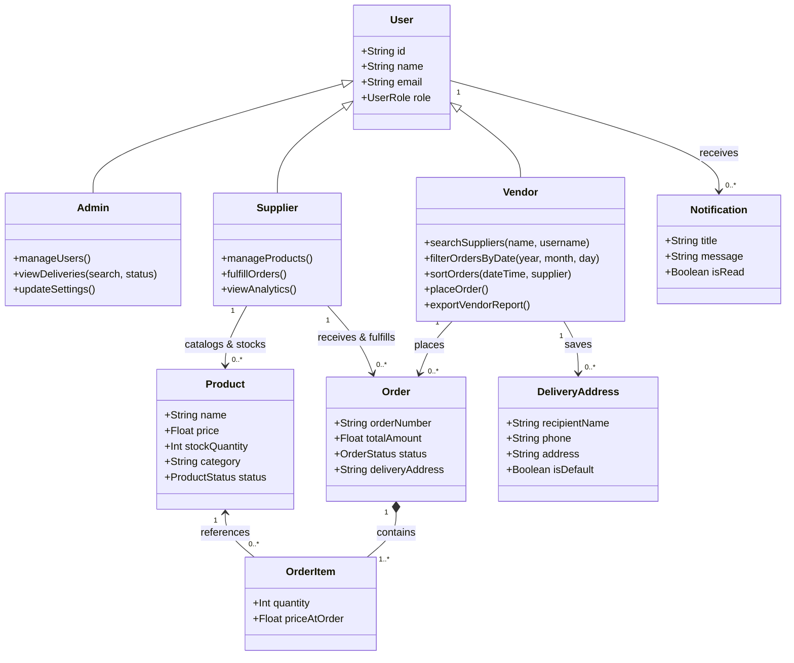
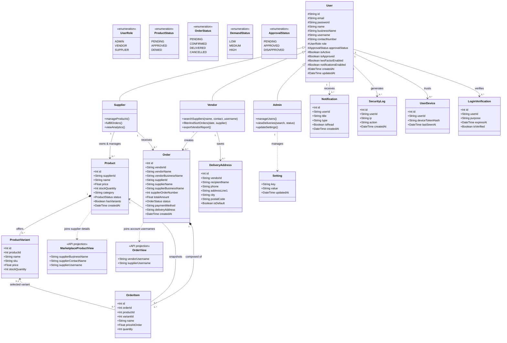
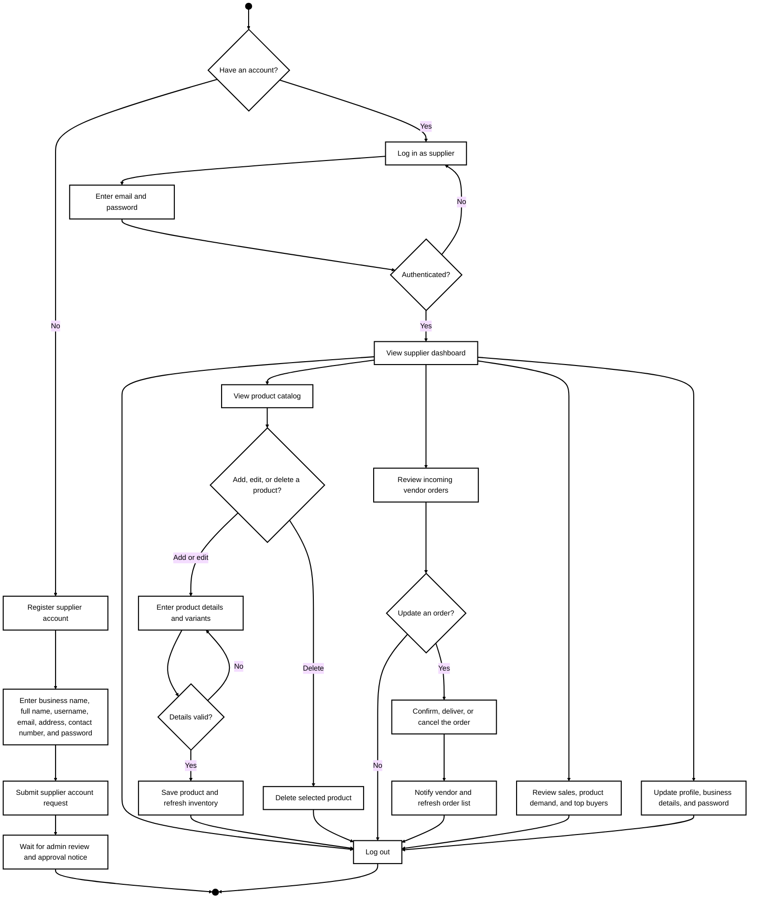
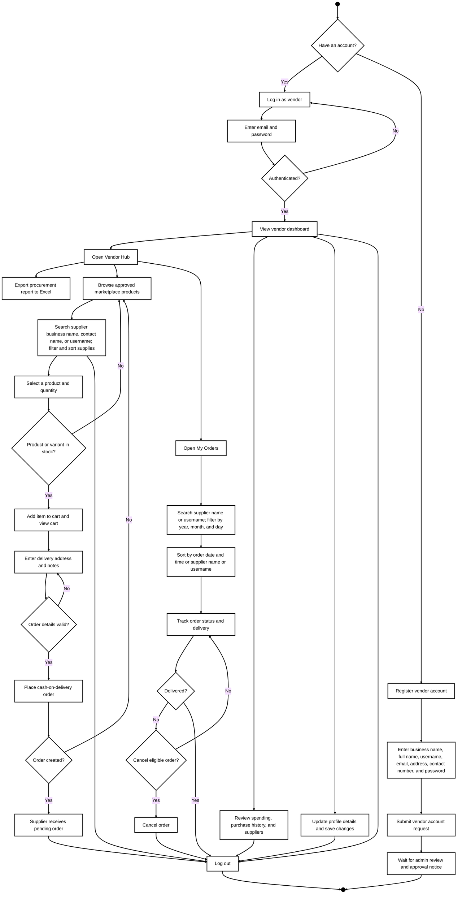
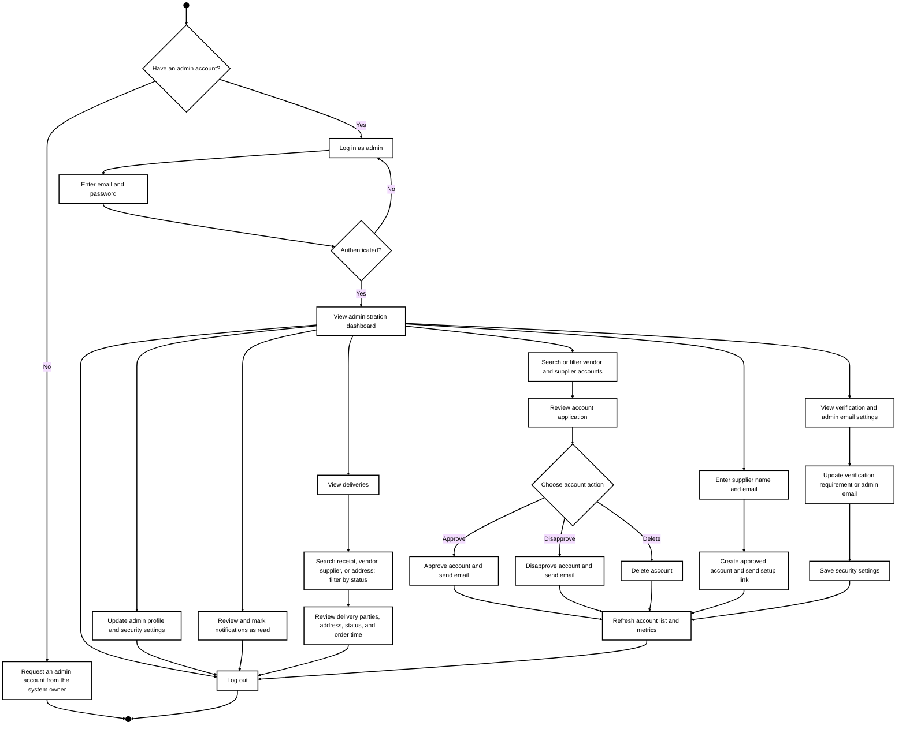

# VendLink Diagrams

All system diagrams are maintained in this file. The section identifiers are used by `scripts/generate_diagrams.py` to create the previews. The detailed model follows the persisted entities in `schema.sql`; usernames shown with marketplace products and orders are joined from `User`, not stored as product or order columns. SVG exports stay sharp at any size in Word; PNG exports are rendered at high resolution with 300 DPI metadata.

## Class Diagrams

### simplified-class-diagram

### detailed-class-diagram

`Admin`, `Vendor`, and `Supplier` are role-specific views of rows in `users` (selected by `users.role`), not separate database tables. `MarketplaceProductView` and `OrderView` are API projections; their username and supplier account fields are joined from `users`.

## Activity Diagrams

### supplier-activity-diagram

### vendor-activity-diagram

### admin-activity-diagram

